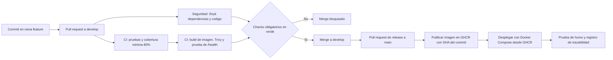

# API de Tareas — Pipeline CI/CD (DOY0101 Ingeniería DevOps)

API REST mínima para gestionar tareas, hecha con FastAPI. El foco de este repositorio no es la
aplicación, sino el ciclo de vida completo del microservicio: control de versiones con GitFlow
(Evaluación Parcial 1) y un pipeline CI/CD en GitHub Actions con contenedores, pruebas
automatizadas, análisis de seguridad, despliegue automático y orquestación (Evaluación Parcial 2).

## Ejecución local

Sin Docker:

```bash
python -m venv .venv
.venv\Scripts\activate                    # En Linux/Mac: source .venv/bin/activate
pip install -r requirements-dev.txt
uvicorn app.main:app --reload             # http://localhost:8000/docs
python -m pytest --cov=app                # pruebas con cobertura
```

Con Docker (API + nginx):

```bash
docker compose up -d --build              # http://localhost:8080/docs
docker compose ps                         # estado y salud de los servicios
docker compose down
```

## Endpoints

| Método | Ruta           | Descripción                                   |
|--------|----------------|-----------------------------------------------|
| GET    | `/health`      | Estado del servicio                           |
| POST   | `/tareas`      | Crea una tarea (el título no puede ser vacío) |
| GET    | `/tareas`      | Lista todas las tareas                        |
| GET    | `/tareas/{id}` | Obtiene una tarea                             |
| DELETE | `/tareas/{id}` | Elimina una tarea                             |

## Estructura del repositorio

```
.
├── app/                        # Código de la aplicación
│   ├── __init__.py
│   └── main.py
├── tests/                      # Pruebas automatizadas (pytest)
│   └── test_api.py
├── .github/
│   ├── dependabot.yml          # Actualización automática de dependencias
│   └── workflows/
│       ├── ci.yml              # Pruebas, cobertura, imagen y Trivy
│       ├── seguridad.yml       # Análisis con Snyk
│       └── despliegue.yml      # Publicación en GHCR y despliegue
├── Dockerfile                  # Imagen del microservicio
├── .dockerignore
├── docker-compose.yml          # Orquestación: api + proxy nginx
├── nginx.conf
├── requirements.txt            # Dependencias de producción
├── requirements-dev.txt        # Dependencias de pruebas
├── pytest.ini
└── README.md
```

## Flujo de trabajo: GitFlow

Se eligió **GitFlow** en lugar de trunk-based development o GitHub Flow.

**Justificación**

- Existe una rama `develop` donde se integra el trabajo en curso, y `main` queda siempre con
  código estable y etiquetado (`vX.Y.Z`). Esto separa lo que se está construyendo de lo que ya
  está listo, y da trazabilidad.
- Los hotfix tienen un camino propio (`hotfix/*` desde `main`), así que una corrección urgente
  no depende de que `develop` esté estable.
- Es adecuado para un proyecto con versiones explícitas y revisión por pull request. Trunk-based
  exige integración muy frecuente y feature flags; GitHub Flow no tiene una rama de integración
  previa a producción.

**Contra asumido:** más ramas y más pasos de merge que trunk-based. Para un equipo pequeño es un
costo aceptable a cambio de orden y claridad.

### Ramas

| Rama               | Se crea desde | Se integra en      | Propósito                                  |
|--------------------|---------------|--------------------|--------------------------------------------|
| `main`             | —             | —                  | Código estable. Cada release lleva un tag. |
| `develop`          | `main`        | `main` (release)   | Integración del trabajo en curso.          |
| `feature/<nombre>` | `develop`     | `develop`          | Una funcionalidad o mejora.                |
| `hotfix/<nombre>`  | `main`        | `main` y `develop` | Corrección urgente de un error.            |

### Convenciones

**Naming de ramas:** `tipo/descripcion-en-kebab-case`, en minúsculas y sin espacios ni tildes.
Ejemplos: `feature/eliminar-tarea`, `feature/dockerfile`, `hotfix/validar-titulo-vacio`.

**Mensajes de commit (Conventional Commits):**

```
<tipo>(<alcance opcional>): <descripción en imperativo, minúscula, sin punto final>
```

| Tipo       | Uso                                         |
|------------|---------------------------------------------|
| `feat`     | Nueva funcionalidad                         |
| `fix`      | Corrección de un error                      |
| `test`     | Agregar o modificar pruebas                 |
| `docs`     | Documentación                               |
| `ci`       | Cambios en GitHub Actions                   |
| `chore`    | Mantenimiento (configuración, dependencias) |
| `refactor` | Cambio de código sin alterar comportamiento |

### Flujo de merge

1. **Feature:** `develop` → rama `feature/x` → commits → **pull request a `develop`** → checks en
   verde → merge con commit de merge.
2. **Release:** cuando `develop` está estable → **PR de `develop` a `main`** → checks en verde →
   merge → tag `vX.Y.Z` → despliegue automático.
3. **Hotfix:** `main` → rama `hotfix/x` → **PR a `main`** → tag `vX.Y.Z` → **PR de vuelta a
   `develop`** para no perder la corrección.
4. No se hace push directo a `main` ni a `develop`: todo entra por pull request.

### Estrategia de revisión

- Todo cambio entra por pull request, con título en formato Conventional Commits y una
  descripción de qué cambia y por qué.
- Antes de fusionar se revisa que el cambio haga lo que dice, que tenga pruebas y que todos los
  checks del pipeline estén en verde (la protección de ramas lo exige).
- Los PR son pequeños y de un solo propósito.

### Versionado

[Versionado semántico](https://semver.org/lang/es/) `MAJOR.MINOR.PATCH`, con tags anotados en `main`:

- `v1.0.0`: primera versión estable (API con endpoint de eliminación y CI).
- `v1.0.1`: hotfix que rechaza tareas con título vacío.
- Versiones siguientes (`v1.1.0` en adelante): documentación y pipeline CI/CD completo
  (contenedores, seguridad y despliegue automático).

## Pipeline CI/CD

### Diagrama



### Workflows de GitHub Actions

| Archivo | Cuándo corre | Qué hace |
|---------|--------------|----------|
| `.github/workflows/ci.yml` | Push y pull request hacia `main` y `develop` | Job `pruebas`: PyTest con cobertura mínima del 80 %. Job `imagen` (depende de `pruebas`): construye la imagen Docker, la escanea con Trivy (falla ante vulnerabilidades altas o críticas con corrección disponible) y comprueba `/health` en un contenedor. |
| `.github/workflows/seguridad.yml` | Push y pull request hacia `main` y `develop` | Snyk: análisis de dependencias (`snyk test`) y de código (`snyk code test`), con umbral de severidad alta. No se ejecuta en los PR de Dependabot. |
| `.github/workflows/despliegue.yml` | Push a `main` | Job `publicar`: construye y sube la imagen a GitHub Container Registry (GHCR) con el SHA del commit como etiqueta. Job `desplegar`: descarga esa imagen desde GHCR, levanta Docker Compose, ejecuta la prueba de humo y registra el commit desplegado. |
| `.github/dependabot.yml` | Semanal | Propone actualizaciones de `pip`, `docker` y `github-actions` mediante pull requests hacia `develop`. |

Todos los workflows se ejecutan en un entorno cloud simulado (runners `ubuntu-latest` de GitHub),
sin depender de la máquina de ninguna persona.

### Contenedores y orquestación

| Servicio | Imagen | Función |
|----------|--------|---------|
| `api` | Construida desde el `Dockerfile` (`python:3.12-slim`) | API de tareas en el puerto 8000, accesible solo dentro de la red de Compose |
| `proxy` | `nginx:1.27-alpine` | Único servicio expuesto (puerto 8080); reenvía las peticiones a `api` |

**Dockerfile:** imagen base `slim`, instalación de dependencias en una capa propia (aprovecha la
caché), ejecución con usuario no root y `HEALTHCHECK` sobre `/health`. El archivo `.dockerignore`
deja fuera `tests/`, `.git` y otros archivos innecesarios. Las dependencias de pruebas viven en
`requirements-dev.txt`, de modo que la imagen de producción no las incluye.

**Docker Compose (`docker-compose.yml`):**
- `proxy` depende de `api` con `condition: service_healthy`: nginx no arranca hasta que `/health` responde.
- `restart: unless-stopped` en ambos servicios.
- La imagen de `api` se parametriza con la variable `API_IMAGE`, que el pipeline de despliegue
  usa para levantar exactamente la imagen publicada en GHCR.

### Parámetros de escalabilidad y seguridad

| Aspecto | Parámetro |
|---------|-----------|
| Escalabilidad | Límites de recursos de `api`: 0.50 CPU y 256 MB de memoria; reinicio automático; healthchecks para el control de arranque |
| Seguridad del contenedor | Usuario no root, sistema de archivos de solo lectura (`read_only`, con `tmpfs` en `/tmp`), `cap_drop: ALL` y `no-new-privileges` |
| Seguridad de la cadena | Dependabot, Trivy y Snyk; protección de ramas con checks obligatorios |

### Calidad

- Las pruebas unitarias se ejecutan en cada pull request y en cada push a `main` y `develop`.
- Política de calidad: si la cobertura baja del 80 %, el pipeline falla.
- Las ramas `main` y `develop` tienen protección: exigen pull request y que los checks
  `Pruebas unitarias y cobertura`, `Construir, escanear y probar la imagen` y `Analisis con Snyk`
  estén en verde antes de fusionar.

### Seguridad

- **Dependabot:** escaneo de dependencias de Python, de la imagen base de Docker y de las Actions.
  Sus actualizaciones llegan como pull requests y solo se fusionan si el pipeline pasa.
- **Trivy:** escaneo de la imagen Docker; bloquea ante hallazgos altos o críticos con corrección disponible.
- **Snyk:** análisis de dependencias y de código fuente; bloquea ante hallazgos de severidad alta.
- **Bloqueo:** cuando cualquier análisis falla, el check queda en rojo y GitHub impide fusionar el pull request.

### Despliegue

Al llegar código a `main`, el workflow `despliegue.yml` publica la imagen en GHCR, la descarga en
otro runner, levanta los servicios con Docker Compose, comprueba `/health` a través de nginx y
apaga el entorno simulado al terminar.

### Trazabilidad

Cada despliegue se puede seguir de punta a punta:

1. Un commit en una rama `feature/*` o `hotfix/*`.
2. El pull request que lo integró, con sus checks de calidad y seguridad.
3. El merge a `main`, identificado con un tag `vX.Y.Z`.
4. La imagen en GHCR etiquetada con el **SHA del commit**, con las etiquetas OCI
   `org.opencontainers.image.revision` y `org.opencontainers.image.source`.
5. El despliegue registrado en el *environment* `produccion` (pestaña *Deployments*), cuyo
   resumen muestra la imagen y el commit desplegados.

El historial se puede revisar con `git log --oneline --graph --all`, en la pestaña *Pull requests*,
en *Actions*, en *Packages* y en *Deployments* del repositorio.

### Limitaciones conocidas

- Las tareas se guardan en memoria: no hay persistencia y se mantiene una sola réplica de `api`.

### Justificación de decisiones técnicas

_Para el desarrollo del proyecto decidí utilizar Docker, ya que permite ejecutar la aplicación en un entorno controlado y facilita su funcionamiento en diferentes equipos. Además, el uso de contenedores permite mantener separadas las dependencias de la aplicación y simplifica el proceso de despliegue.

También utilicé Docker Compose para facilitar la ejecución y administración de los contenedores del proyecto. Esto permite levantar los servicios necesarios mediante una configuración definida, haciendo que el proceso sea más ordenado y fácil de repetir.

En cuanto a la calidad del código, se implementaron pruebas automatizadas y se estableció una cobertura mínima del 80 %. El objetivo de esta decisión fue asegurar que las funcionalidades principales de la aplicación fueran comprobadas antes de integrar nuevos cambios o realizar un despliegue.

Para la seguridad utilicé Snyk como herramienta de análisis. Esta permite detectar posibles vulnerabilidades en las dependencias y en el código del proyecto, ayudando a identificar problemas antes de que la aplicación sea desplegada.

Finalmente, utilicé GitHub Actions para automatizar diferentes etapas del proyecto, como la ejecución de pruebas y los análisis de seguridad. Esto permite validar los cambios de forma automática y mantener un proceso más ordenado durante el desarrollo y despliegue de la aplicación.

Al tratarse de un proyecto desarrollado de forma individual, estas herramientas también permitieron organizar mejor el trabajo y automatizar tareas que, de otra manera, deberían realizarse manualmente._

## Declaración de uso de IA

- Herramienta: Claude (Anthropic).
- Uso: El usado dado a la IA fue apoyo para generar el proyecto base, explicar comandos de Git y
  borradores de configuración, todo revisado y validado por mí_

## Conclusiones y reflexión individual

### Reflexión de _Benjamin Tapia

_Aprendí a utilizar el workflow, actions, entre otras funciones, además de poder entender de mejor manera el funcionamiento de GITHUB_
