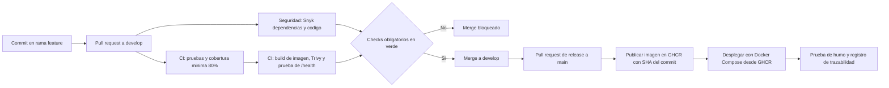
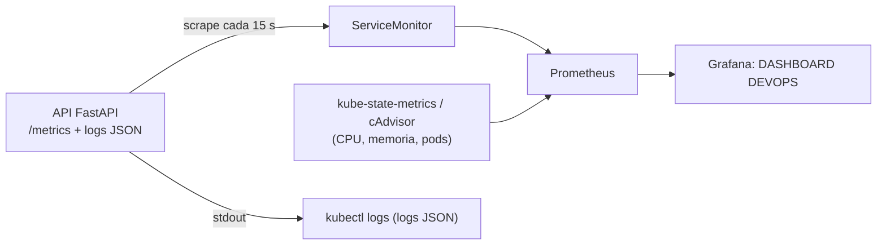
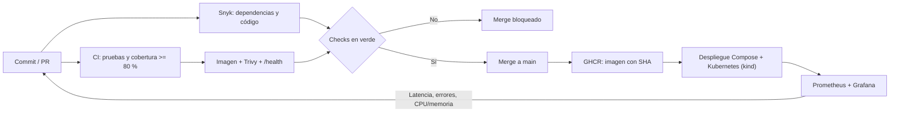

# API de Tareas — Pipeline CI/CD (DOY0101 Ingeniería DevOps)

API REST mínima para gestionar tareas, hecha con FastAPI. El foco de este repositorio no es la
aplicación, sino el ciclo de vida completo del microservicio: control de versiones con GitFlow
(Evaluación Parcial 1) y un pipeline CI/CD en GitHub Actions con contenedores, pruebas
automatizadas, análisis de seguridad, despliegue automático y orquestación (Evaluación Parcial 2),
más observabilidad, dashboard y cumplimiento automatizado (Evaluación Parcial 3).

## Ejecución local

Sin Docker:

```bash
python -m venv .venv
.venv\Scripts\activate                    # En Linux/Mac: source .venv/bin/activate
pip install -r requirements-dev.txt
uvicorn app.main:app --reload             # http://localhost:8000/docs
python -m pytest --cov=app                # pruebas con cobertura
```

Con Docker (API + nginx):

```bash
docker compose up -d --build              # http://localhost:8080/docs
docker compose ps                         # estado y salud de los servicios
docker compose down
```

## Endpoints

| Método | Ruta           | Descripción                                   |
|--------|----------------|-----------------------------------------------|
| GET    | `/health`      | Estado del servicio                           |
| POST   | `/tareas`      | Crea una tarea (el título no puede ser vacío) |
| GET    | `/tareas`      | Lista todas las tareas                        |
| GET    | `/tareas/{id}` | Obtiene una tarea                             |
| DELETE | `/tareas/{id}` | Elimina una tarea                             |

## Estructura del repositorio

```
.
├── app/                        # Código de la aplicación
│   ├── __init__.py
│   └── main.py
├── tests/                      # Pruebas automatizadas (pytest)
│   └── test_api.py
├── .github/
│   ├── dependabot.yml          # Actualización automática de dependencias
│   └── workflows/
│       ├── ci.yml              # Pruebas, cobertura, imagen y Trivy
│       ├── seguridad.yml       # Análisis con Snyk
│       └── despliegue.yml      # Publicación en GHCR y despliegue
├── k8s/
│   ├── api.yaml                # Namespace, Deployment (2 réplicas) y Service
│   └── servicemonitor.yaml     # Le indica a Prometheus qué monitorear
├── monitoring/
│   └── dashboard-devops.json   # Dashboard de Grafana exportado
├── docs/img/                   # Capturas de la documentación
├── Dockerfile                  # Imagen del microservicio
├── .dockerignore
├── docker-compose.yml          # Orquestación: api + proxy nginx
├── nginx.conf
├── requirements.txt            # Dependencias de producción
├── requirements-dev.txt        # Dependencias de pruebas
├── pytest.ini
└── README.md
```

## Flujo de trabajo: GitFlow

Se eligió **GitFlow** en lugar de trunk-based development o GitHub Flow.

**Justificación**

- Existe una rama `develop` donde se integra el trabajo en curso, y `main` queda siempre con
  código estable y etiquetado (`vX.Y.Z`). Esto separa lo que se está construyendo de lo que ya
  está listo, y da trazabilidad.
- Los hotfix tienen un camino propio (`hotfix/*` desde `main`), así que una corrección urgente
  no depende de que `develop` esté estable.
- Es adecuado para un proyecto con versiones explícitas y revisión por pull request. Trunk-based
  exige integración muy frecuente y feature flags; GitHub Flow no tiene una rama de integración
  previa a producción.

**Contra asumido:** más ramas y más pasos de merge que trunk-based. Para un equipo pequeño es un
costo aceptable a cambio de orden y claridad.

### Ramas

| Rama               | Se crea desde | Se integra en      | Propósito                                  |
|--------------------|---------------|--------------------|--------------------------------------------|
| `main`             | —             | —                  | Código estable. Cada release lleva un tag. |
| `develop`          | `main`        | `main` (release)   | Integración del trabajo en curso.          |
| `feature/<nombre>` | `develop`     | `develop`          | Una funcionalidad o mejora.                |
| `hotfix/<nombre>`  | `main`        | `main` y `develop` | Corrección urgente de un error.            |

### Convenciones

**Naming de ramas:** `tipo/descripcion-en-kebab-case`, en minúsculas y sin espacios ni tildes.
Ejemplos: `feature/eliminar-tarea`, `feature/dockerfile`, `hotfix/validar-titulo-vacio`.

**Mensajes de commit (Conventional Commits):**

```
<tipo>(<alcance opcional>): <descripción en imperativo, minúscula, sin punto final>
```

| Tipo       | Uso                                         |
|------------|---------------------------------------------|
| `feat`     | Nueva funcionalidad                         |
| `fix`      | Corrección de un error                      |
| `test`     | Agregar o modificar pruebas                 |
| `docs`     | Documentación                               |
| `ci`       | Cambios en GitHub Actions                   |
| `chore`    | Mantenimiento (configuración, dependencias) |
| `refactor` | Cambio de código sin alterar comportamiento |

### Flujo de merge

1. **Feature:** `develop` → rama `feature/x` → commits → **pull request a `develop`** → checks en
   verde → merge con commit de merge.
2. **Release:** cuando `develop` está estable → **PR de `develop` a `main`** → checks en verde →
   merge → tag `vX.Y.Z` → despliegue automático.
3. **Hotfix:** `main` → rama `hotfix/x` → **PR a `main`** → tag `vX.Y.Z` → **PR de vuelta a
   `develop`** para no perder la corrección.
4. No se hace push directo a `main` ni a `develop`: todo entra por pull request.

### Estrategia de revisión

- Todo cambio entra por pull request, con título en formato Conventional Commits y una
  descripción de qué cambia y por qué.
- Antes de fusionar se revisa que el cambio haga lo que dice, que tenga pruebas y que todos los
  checks del pipeline estén en verde (la protección de ramas lo exige).
- Los PR son pequeños y de un solo propósito.

### Versionado

[Versionado semántico](https://semver.org/lang/es/) `MAJOR.MINOR.PATCH`, con tags anotados en `main`:

- `v1.0.0`: primera versión estable (API con endpoint de eliminación y CI).
- `v1.0.1`: hotfix que rechaza tareas con título vacío.
- Versiones siguientes (`v1.1.0` en adelante): documentación y pipeline CI/CD completo
  (contenedores, seguridad y despliegue automático).

## Pipeline CI/CD

### Diagrama



### Workflows de GitHub Actions

| Archivo | Cuándo corre | Qué hace |
|---------|--------------|----------|
| `.github/workflows/ci.yml` | Push y pull request hacia `main` y `develop` | Job `pruebas`: PyTest con cobertura mínima del 80 %. Job `imagen` (depende de `pruebas`): construye la imagen Docker, la escanea con Trivy (falla ante vulnerabilidades altas o críticas con corrección disponible) y comprueba `/health` en un contenedor. |
| `.github/workflows/seguridad.yml` | Push y pull request hacia `main` y `develop` | Snyk: análisis de dependencias (`snyk test`) y de código (`snyk code test`), con umbral de severidad alta. No se ejecuta en los PR de Dependabot. |
| `.github/workflows/despliegue.yml` | Push a `main` | Job `publicar`: construye y sube la imagen a GitHub Container Registry (GHCR) con el SHA del commit como etiqueta. Job `desplegar`: descarga esa imagen desde GHCR, levanta Docker Compose, ejecuta la prueba de humo y registra el commit desplegado. |
| `.github/dependabot.yml` | Semanal | Propone actualizaciones de `pip`, `docker` y `github-actions` mediante pull requests hacia `develop`. |

Todos los workflows se ejecutan en un entorno cloud simulado (runners `ubuntu-latest` de GitHub),
sin depender de la máquina de ninguna persona.

### Contenedores y orquestación

| Servicio | Imagen | Función |
|----------|--------|---------|
| `api` | Construida desde el `Dockerfile` (`python:3.12-slim`) | API de tareas en el puerto 8000, accesible solo dentro de la red de Compose |
| `proxy` | `nginx:1.27-alpine` | Único servicio expuesto (puerto 8080); reenvía las peticiones a `api` |

**Dockerfile:** imagen base `slim`, instalación de dependencias en una capa propia (aprovecha la
caché), ejecución con usuario no root y `HEALTHCHECK` sobre `/health`. El archivo `.dockerignore`
deja fuera `tests/`, `.git` y otros archivos innecesarios. Las dependencias de pruebas viven en
`requirements-dev.txt`, de modo que la imagen de producción no las incluye.

**Docker Compose (`docker-compose.yml`):**
- `proxy` depende de `api` con `condition: service_healthy`: nginx no arranca hasta que `/health` responde.
- `restart: unless-stopped` en ambos servicios.
- La imagen de `api` se parametriza con la variable `API_IMAGE`, que el pipeline de despliegue
  usa para levantar exactamente la imagen publicada en GHCR.

### Parámetros de escalabilidad y seguridad

| Aspecto | Parámetro |
|---------|-----------|
| Escalabilidad | Límites de recursos de `api`: 0.50 CPU y 256 MB de memoria; reinicio automático; healthchecks para el control de arranque |
| Seguridad del contenedor | Usuario no root, sistema de archivos de solo lectura (`read_only`, con `tmpfs` en `/tmp`), `cap_drop: ALL` y `no-new-privileges` |
| Seguridad de la cadena | Dependabot, Trivy y Snyk; protección de ramas con checks obligatorios |

### Calidad

- Las pruebas unitarias se ejecutan en cada pull request y en cada push a `main` y `develop`.
- Política de calidad: si la cobertura baja del 80 %, el pipeline falla.
- Las ramas `main` y `develop` tienen protección: exigen pull request y que los checks
  `Pruebas unitarias y cobertura`, `Construir, escanear y probar la imagen` y `Analisis con Snyk`
  estén en verde antes de fusionar.

### Seguridad

- **Dependabot:** escaneo de dependencias de Python, de la imagen base de Docker y de las Actions.
  Sus actualizaciones llegan como pull requests y solo se fusionan si el pipeline pasa.
- **Trivy:** escaneo de la imagen Docker; bloquea ante hallazgos altos o críticos con corrección disponible.
- **Snyk:** análisis de dependencias y de código fuente; bloquea ante hallazgos de severidad alta.
- **Bloqueo:** cuando cualquier análisis falla, el check queda en rojo y GitHub impide fusionar el pull request.

### Despliegue

Al llegar código a `main`, el workflow `despliegue.yml` publica la imagen en GHCR, la descarga en
otro runner, levanta los servicios con Docker Compose, comprueba `/health` a través de nginx y
apaga el entorno simulado al terminar.

### Trazabilidad

Cada despliegue se puede seguir de punta a punta:

1. Un commit en una rama `feature/*` o `hotfix/*`.
2. El pull request que lo integró, con sus checks de calidad y seguridad.
3. El merge a `main`, identificado con un tag `vX.Y.Z`.
4. La imagen en GHCR etiquetada con el **SHA del commit**, con las etiquetas OCI
   `org.opencontainers.image.revision` y `org.opencontainers.image.source`.
5. El despliegue registrado en el *environment* `produccion` (pestaña *Deployments*), cuyo
   resumen muestra la imagen y el commit desplegados.

El historial se puede revisar con `git log --oneline --graph --all`, en la pestaña *Pull requests*,
en *Actions*, en *Packages* y en *Deployments* del repositorio.

### Justificación de decisiones técnicas

_Para el desarrollo del proyecto decidí utilizar Docker, ya que permite ejecutar la aplicación en un entorno controlado y facilita su funcionamiento en diferentes equipos. Además, el uso de contenedores permite mantener separadas las dependencias de la aplicación y simplifica el proceso de despliegue.

También utilicé Docker Compose para facilitar la ejecución y administración de los contenedores del proyecto. Esto permite levantar los servicios necesarios mediante una configuración definida, haciendo que el proceso sea más ordenado y fácil de repetir.

En cuanto a la calidad del código, se implementaron pruebas automatizadas y se estableció una cobertura mínima del 80 %. El objetivo de esta decisión fue asegurar que las funcionalidades principales de la aplicación fueran comprobadas antes de integrar nuevos cambios o realizar un despliegue.

Para la seguridad utilicé Snyk como herramienta de análisis. Esta permite detectar posibles vulnerabilidades en las dependencias y en el código del proyecto, ayudando a identificar problemas antes de que la aplicación sea desplegada.

Finalmente, utilicé GitHub Actions para automatizar diferentes etapas del proyecto, como la ejecución de pruebas y los análisis de seguridad. Esto permite validar los cambios de forma automática y mantener un proceso más ordenado durante el desarrollo y despliegue de la aplicación._

## Evaluación Parcial 3: Observabilidad, métricas y cumplimiento

> Esta sección extiende el pipeline de la Evaluación Parcial 2 con monitoreo, dashboard,
> políticas de cumplimiento y una demostración de que el pipeline se detiene ante fallas críticas.

### 1. Monitoreo y logging (IE1)

La aplicación expone telemetría por sí misma, y Prometheus y Grafana la recolectan y la muestran.

| Elemento | Dónde está | Qué entrega |
|----------|-----------|-------------|
| Métricas HTTP | `app/main.py`, con `prometheus-fastapi-instrumentator`, endpoint `/metrics` | `http_requests_total` (peticiones y código de estado), `http_request_duration_highr_seconds` (latencia) |
| Métrica propia | `app/main.py`, `Gauge("tareas_total")` | Cantidad de tareas almacenadas por pod |
| Logs estructurados | `app/main.py`, clase `FormatoJson` y middleware | Una línea JSON por petición: `ts`, `level`, `logger`, `msg`, `method`, `path`, `status`, `duration_ms`. Los errores no controlados registran el *traceback*. `/health` y `/metrics` se excluyen para no generar ruido. |
| Endpoint de prueba | `GET /simular-error` | Genera un error 500 a propósito para probar métricas, logs y el panel de errores |
| Recolección | `k8s/servicemonitor.yaml` | Prometheus consulta `/metrics` de cada pod cada 15 s |
| Visualización | Grafana | Dashboard `DASHBOARD DEVOPS` (ver sección 3) |



**Instalación de Prometheus y Grafana** (kube-prometheus-stack con Helm, en un clúster local kind):

```bash
# 1. Clúster local
kind create cluster --name tareas

# 2. Prometheus + Grafana + kube-state-metrics
helm repo add prometheus-community https://prometheus-community.github.io/helm-charts
helm repo update
helm install prometheus prometheus-community/kube-prometheus-stack \
  --namespace monitoring --create-namespace

# 3. Imagen y despliegue de la API
docker build -t tareas-api:local .
kind load docker-image tareas-api:local --name tareas
kubectl apply -f k8s/api.yaml
kubectl apply -f k8s/servicemonitor.yaml

# 4. Acceso a Grafana (http://localhost:3000) y Prometheus (http://localhost:9090)
kubectl -n monitoring port-forward svc/prometheus-grafana 3000:80
kubectl -n monitoring port-forward svc/prometheus-kube-prometheus-prometheus 9090:9090

# Contraseña de Grafana (usuario: admin)
kubectl -n monitoring get secret prometheus-grafana -o jsonpath="{.data.admin-password}" | base64 -d
```

Grafana usa Prometheus como fuente de datos (viene preconfigurada por el chart). Los puertos
8000 (API, donde Prometheus lee `/metrics`) y 3000 (interfaz de Grafana) corresponden a
servicios distintos.

**Disponibilidad:** el panel *Pods arriba* usa la métrica `up` de Prometheus; si un pod deja
de responder `/metrics`, el valor baja.


### 2. Despliegue en Kubernetes (IE2)

Los manifiestos están en `k8s/`:

- `api.yaml`: namespace `tareas`, `Deployment` con **2 réplicas**, `readinessProbe` y
  `livenessProbe` sobre `/health`, `requests` (100m CPU, 128Mi) y `limits` (500m CPU, 256Mi),
  `securityContext` endurecido (sin escalado de privilegios, sistema de archivos de solo lectura,
  sin capabilities) y un `Service` en el puerto 80.
- `servicemonitor.yaml`: le indica a Prometheus qué servicio y puerto monitorear.

**Despliegue automatizado:** el job `kubernetes` de `.github/workflows/despliegue.yml` corre en un
runner de GitHub (entorno cloud) cuando hay un push a `main`:

1. Crea un clúster Kubernetes efímero con **kind**.
2. Descarga la imagen publicada en GHCR (etiquetada con el SHA del commit) y la carga en el clúster.
3. Aplica `k8s/api.yaml` reemplazando la imagen por la del commit.
4. Espera el `rollout status` del Deployment.
5. Ejecuta una prueba de humo sobre `/health` mediante `port-forward`.

El `ServiceMonitor` se aplica en el clúster local donde corre Prometheus (kind), con
`kubectl apply -f k8s/servicemonitor.yaml`. No se aplica en el job de GitHub Actions porque ese
clúster efímero no tiene las CRD de Prometheus Operator. Para que Prometheus lo detecte, el
ServiceMonitor lleva la etiqueta `release: prometheus` (el nombre del release de Helm).
Se puede comprobar en Prometheus, en *Status > Targets*.

### 3. Dashboard (IE3)

Archivo exportado: [`monitoring/dashboard-devops.json`](monitoring/dashboard-devops.json).


| Panel | Consulta (PromQL) | Qué muestra |
|-------|-------------------|-------------|
| Peticiones/seg | `sum(rate(http_requests_total{namespace="tareas"}[1m]))` | Tráfico del servicio |
| Errores 5xx | `sum(rate(http_requests_total{namespace="tareas",status="5xx"}[5m])) or vector(0)` | Errores del servidor por segundo |
| Latencia p95 | `histogram_quantile(0.95, sum by (le) (rate(http_request_duration_highr_seconds_bucket{namespace="tareas"}[5m])))` | Tiempo de respuesta del 95 % de las peticiones |
| Tareas almacenadas | `tareas_total` | Estado de la aplicación por pod |
| Pods arriba | `sum(up{namespace="tareas"})` | Disponibilidad |
| Uso de CPU (por pod) | `sum by (pod) (rate(container_cpu_usage_seconds_total{namespace="tareas",container="api"}[5m]))` | Consumo de CPU |
| Uso de memoria (por pod) | `sum by (pod) (container_memory_working_set_bytes{namespace="tareas",container="api"})` | Consumo de memoria |
| Antigüedad de despliegue | `time() - kube_pod_start_time{namespace="tareas"}` | Segundos desde que arrancó cada pod |

**Métricas del proceso CI/CD:**

- **Tiempo de despliegue:** se ve en la duración de cada job del workflow `Despliegue` (*Actions*), y en
  el dashboard como antigüedad de los pods desde el último despliegue.

Estas dos métricas provienen de GitHub Actions y no de Prometheus, porque el runner es efímero.

### 4. Políticas de cumplimiento (IE5)

| Política | Herramienta | Cómo se aplica |
|----------|-------------|----------------|
| Nada entra a `main` ni `develop` sin revisión y checks | Branch protection de GitHub | Exige pull request y los checks `Pruebas unitarias y cobertura`, `Construir, escanear y probar la imagen` y `Analisis con Snyk` |
| Calidad mínima de pruebas | pytest-cov | Falla si la cobertura baja del 80 % |
| Dependencias y código sin vulnerabilidades altas | Snyk (`snyk test` y `snyk code test`) | `--severity-threshold=high` |
| Imagen sin vulnerabilidades altas o críticas corregibles | Trivy | `--severity HIGH,CRITICAL --ignore-unfixed --exit-code 1` |
| Dependencias al día | Dependabot | PR semanales hacia `develop` (pip, docker y Actions) |
| Trazabilidad | Etiquetas OCI + SHA | Cada imagen en GHCR lleva `org.opencontainers.image.revision` y `.source` |


### 5. Demostración: el pipeline se detiene ante una falla (IE6)


**Versión A (cobertura):** se creó una rama desechable `feature/demo-falla-critica` en la que se
eliminaron pruebas de `tests/test_api.py`, de modo que la cobertura bajó del umbral del 80 %. Resultado:

- El check **Pruebas unitarias y cobertura** quedó en **rojo** (`--cov-fail-under=80`).
- GitHub **bloqueó el botón de merge**, así que el cambio no puede llegar a `main` ni desplegarse.

**Versión B (dependencia vulnerable):** se creó una rama desechable `feature/demo-falla-critica`
que agrega la dependencia vulnerable `requests==2.19.0` a `requirements.txt`. Resultado:

- El check **Analisis con Snyk** quedó en **rojo** (`--severity-threshold=high`).
- GitHub **bloqueó el botón de merge**, así que el cambio no puede llegar a `main` ni desplegarse.
- Pull request de la demostración (cerrado sin fusionar): https://github.com/CeliacBoyy/devopstrabaj/pull/N


El workflow de despliegue solo corre con un push a `main`, por lo que una falla en las validaciones
protege el entorno de producción simulado.

### 6. Integración en el pipeline y toma de decisiones (IE4)



### 7. Limitaciones conocidas (actualización)

* Las tareas se guardan en memoria por pod: con 2 réplicas cada pod tiene su propio contenido
  (se ve en el panel *Tareas almacenadas*).
* Los logs son JSON por salida estándar y se consultan con `kubectl logs`; no hay agregación central.
* El clúster de pruebas del pipeline es efímero (kind en un runner de GitHub), no un clúster en producción.
* La cobertura y el tiempo de despliegue no están en Prometheus; se consultan en GitHub Actions.

---

## Declaración de uso de IA

* Herramienta: Claude (Anthropic).
* Uso en la Evaluación 3: Se utilizó inteligencia artificial como apoyo para organizar y estructurar la documentación del proyecto, comprender algunos conceptos relacionados con observabilidad, monitoreo y cumplimiento, y mejorar la redacción de las explicaciones técnicas. También sirvió como apoyo para comprender las consultas PromQL y la función de herramientas como Prometheus, Grafana, Snyk y Trivy.

El desarrollo, configuración y ejecución de las herramientas fueron realizados y comprobados por el equipo en el proyecto. La información generada con apoyo de IA fue revisada y adaptada de acuerdo con lo que realmente se implementó. Las reflexiones personales representan la propia experiencia de cada integrante y aprendizaje durante el desarrollo de la evaluación.

## Conclusiones y reflexión individual

### Reflexión de Benjamin Tapia

Durante el desarrollo de esta evaluación pude comprender mejor la importancia de la observabilidad dentro de un proyecto de software y cómo no basta solamente con que una aplicación funcione, sino que también es necesario poder supervisar su comportamiento, detectar errores y conocer su estado en todo momento.

Uno de los aprendizajes más importantes fue entender cómo trabajan en conjunto Prometheus y Grafana. Prometheus permite recopilar las métricas de la aplicación, mientras que Grafana facilita su visualización mediante dashboards, permitiendo identificar información como la cantidad de peticiones, los errores HTTP, los tiempos de respuesta y el consumo de recursos de los pods. Esto me ayudó a entender cómo se puede detectar un problema antes de que afecte gravemente el funcionamiento de una aplicación.

También aprendí más sobre Kubernetes y la importancia de configurar correctamente los despliegues, las réplicas, las sondas de salud y los recursos asignados a cada contenedor. Además, pude comprender mejor cómo las herramientas de seguridad como Snyk y Trivy ayudan a detectar vulnerabilidades y cómo las políticas de GitHub permiten evitar que cambios que no cumplen con los requisitos lleguen a la rama principal.

Personalmente, considero que una de las partes más importantes de esta evaluación fue comprender que un pipeline no solamente debe construir y desplegar una aplicación, sino que también debe ser capaz de detenerse cuando detecta un problema. Esto permite mantener un mayor control sobre la calidad y seguridad del software.

En general, esta evaluación me permitió reforzar conocimientos de DevOps, monitoreo, automatización y seguridad, además de comprender cómo estas herramientas se complementan dentro de un flujo de trabajo real. Considero que fue una experiencia útil porque pude relacionar distintos conceptos que anteriormente conocía por separado y entender mejor su aplicación en un proyecto completo.
